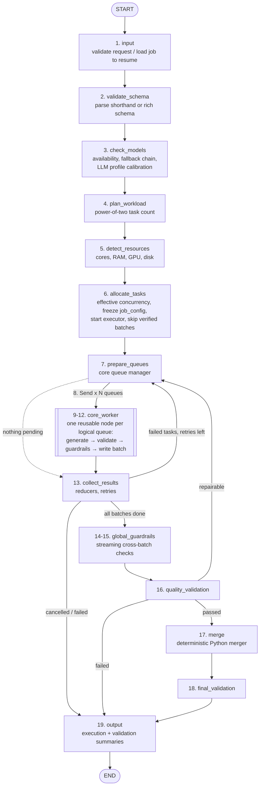
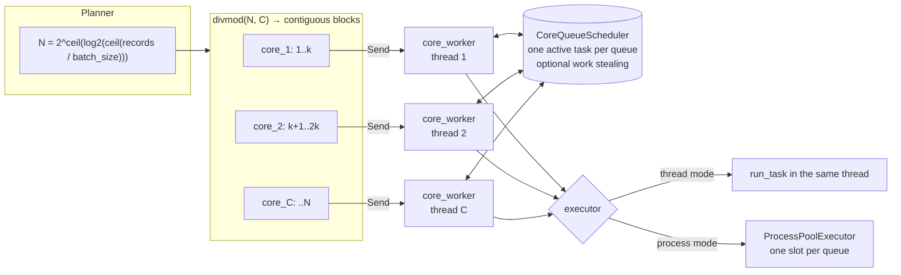
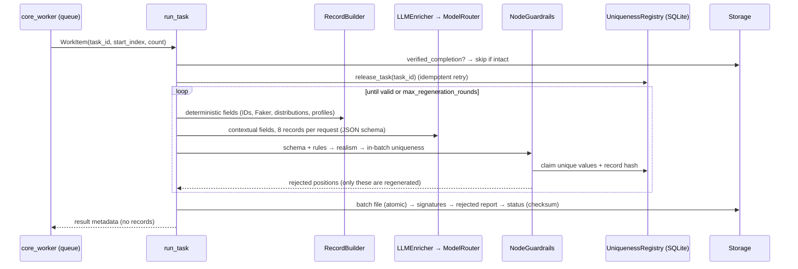

# Architecture and design notes

## 1. LangGraph workflow



The 19 logical steps from the specification map onto 14 graph nodes. Steps 9-12
(generation, node validation, node guardrails, batch writing) run inside the
single reusable `core_worker` node, because they act on the same in-memory batch
and splitting them would force the batch through graph state. Steps 14-15
(global duplicate detection and global guardrails) share one streaming pass over
the batch files for the same reason.

## 2. Scheduling model



* **Logical, not physical, cores.** A queue is a scheduling construct executed by
  one LangGraph worker thread. `os.cpu_count()` (or the process affinity mask)
  sets the default number of queues. Pinning to physical CPUs is opt-in
  (`cpu_affinity: true`) via `SetThreadAffinityMask` (Windows) or
  `sched_setaffinity` (Linux); macOS has no affinity API and is skipped.
* **Why a scheduler on top of `Send`.** `Send` fans work out to parallel node
  invocations in one superstep, but it does not order or group them. The engine
  sends exactly one invocation per queue; that invocation asks the scheduler for
  its next item, so "one task at a time per queue" is enforced by construction.
  It is also asserted (a second `start` on a busy queue raises `SchedulingError`).
* **Work stealing.** When a queue's own work is exhausted it takes the last
  pending item of the queue with the most pending work. The initial allocation
  stays the balanced contiguous split from the specification.
* **Concurrency limits.** `max_concurrency` on `graph.invoke` caps the thread
  pool. Queue count is capped by usable cores, `max_workers`, the task count and
  available RAM (after reserving the loaded model's size from `/api/tags`). LLM
  calls are capped separately by a semaphore: `OLLAMA_NUM_PARALLEL` (default 1)
  for local Ollama, requests-per-minute for cloud providers.
* **Thread vs process mode.** LLM-bound work runs in threads; inference happens
  inside the Ollama server, so the GIL is not the bottleneck. CPU-bound jobs
  (no per-record LLM fields, 20k+ records) default to process mode for real
  multi-core parallelism. Scheduling stays in the parent; worker processes get
  one task at a time and rebuild their services from `job_config.json`.

## 3. Data flow inside one task



## 4. Job directory

```text
output/Jobs_<YYYY-MM-DD>/<schema_name>/<schema_name>_<YYYYMMDD_HHMMSS>_<hex6>/
├── CANCEL                      # present only while a cancellation is requested
├── metadata/
│   ├── job_config.json         # frozen request, schema, model chain, profiles, plan, seed
│   ├── execution_summary.json  # metrics (tasks, records, speed, CPU/RAM/GPU, LLM usage)
│   ├── validation_summary.json # global guardrails, distributions, quality, final checks
│   ├── uniqueness.sqlite       # shared cross-task uniqueness registry
│   ├── tasks/task_0001.json    # per-task status + batch checksum (recovery manifest)
│   └── signatures/batch_0001.npy  # SimHash signatures for cross-batch semantic checks
├── batches/batch_0001.csv
├── rejected/batch_0001_rejected.json
└── final/generated_dataset.csv
```

## 5. Research notes (November 2026)

| Topic | Finding | Consequence in the design |
|---|---|---|
| LangGraph | 1.2.24 is the latest stable release. `from langgraph.types import Send`. A conditional edge returning a list of `Send` runs them in one superstep. Keys written by parallel branches need a reducer. `max_concurrency` is a top-level config key. | One reusable worker node; `Annotated[list, concat]` reducers; results consolidated by `latest_by_task`. Verified locally that Send branches run concurrently in a thread pool. |
| Runtime context | LangGraph 1.x injects `runtime: Runtime[Context]` into nodes, including Send targets. | Non-serialisable objects (scheduler, executor, tracker) travel in the context, not in state. |
| Ollama local | `/api/chat` accepts a JSON schema in `format`; `/api/tags` lists installed models (with size, context length, capabilities); `/api/ps` shows loaded models; `/api/embed` returns embeddings. `OLLAMA_NUM_PARALLEL` defaults to 1. | Schema-constrained output for local models; model size feeds the RAM budget; LLM concurrency defaults to 1. |
| Ollama Cloud | Direct API at `https://ollama.com/api` with `Authorization: Bearer $OLLAMA_API_KEY`. `-cloud` models also work through a signed-in local server. Cloud models do **not** support schema-constrained structured output. | Cloud models use JSON mode plus client-side validation and retries. |
| "Beam" | Reflection AI **Beam 1.0** (501B MoE, 23B active, Apache-2.0, released Oct 2026). On Ollama only as `beam:cloud`; on OpenRouter as `reflection/beam-1.0-501b-a23b`. Not to be confused with Beam.cloud (a serverless GPU platform). | Registered as `ollama_local/beam:cloud` and `openrouter/reflection/beam-1.0-501b-a23b`. |
| "Iceman" | No LLM by this name could be confirmed on Ollama, Hugging Face, OpenRouter or NVIDIA NIM. | Not registered. Add it to `models.json` once its exact provider and model id are known. |
| NVIDIA Nemotron | Ollama library: `nemotron-3-nano` (4b/30b), `nemotron-3-super`, `nemotron-mini`, cloud tags. NVIDIA's hosted API (`https://integrate.api.nvidia.com/v1`) is OpenAI-compatible with a free, rate-limited developer tier. | `nemotron-3-nano:4b` via Ollama and a `nvidia_nim` entry via the OpenAI-compatible adapter. |

### Exact vs semantic deduplication

| Technique | Cost | Catches | Used for |
|---|---|---|---|
| Hash of normalised value (BLAKE2b, 63-bit) | O(1) per value | identical values (case/whitespace-insensitive) | unique fields, whole records |
| SQLite `PRIMARY KEY` claims | one transaction per field per batch | cross-task collisions, atomically, across threads and processes | node-level global uniqueness |
| Sorted numpy hash arrays | O(n log n), 8 bytes per value | cross-batch duplicates at 1M+ scale | global guardrails |
| Char n-gram feature hashing + cosine | numpy matrix product per batch | near-identical free text (small edits) | node-level semantic dedup (default) |
| Neural embeddings (`ollama:nomic-embed-text`) | one embedding call per record | paraphrases | optional (`embedder: "ollama:<model>"`) |
| SimHash + LSH banding | O(n) with bucket caps | cross-batch near duplicates without O(n²) | global semantic dedup |

Semantic dedup only runs on free-text (`llm`) fields. For purely structured
records, two employees with the same name and city are legitimate, and exact
deduplication on unique fields and whole records is the correct guarantee.

### Large-scale bottlenecks and mitigations

* **LLM latency dominates** whenever per-record LLM fields exist (a 0.6B model on
  CPU takes seconds per request). Mitigations: deterministic generation for
  everything that does not need context, 8 records per request, profile
  calibration once per job instead of per record, `OLLAMA_NUM_PARALLEL`-aware
  concurrency.
* **GIL** for CPU-bound Faker/Pydantic work: process mode.
* **Memory**: records never enter graph state; global checks stream batch files
  and keep only compact hash arrays.
* **SQLite contention**: one transaction per field per batch (not per record);
  WAL mode and a 60 s busy timeout.
* **Disk**: free space is checked before the job starts (about three times the
  estimated dataset size: batches plus final file plus headroom).

### Windows and Linux compatibility

* Atomic writes use `os.replace`, which is atomic on both, with retries for
  Windows sharing violations (antivirus, indexers).
* Worker processes use `spawn`-safe entry points and receive everything they need
  through `job_config.json` and pool initializer arguments.
* Cancellation works across processes through a `CANCEL` marker file, since
  signals do not propagate the same way on Windows.
* Paths use `pathlib`; CSV files are written with `newline=""`; all text is UTF-8.
